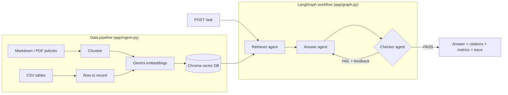

# Agentic RAG on Google Cloud

A multi-agent question-answering service over company documents. It reads **unstructured** files (policies in Markdown/PDF) and **structured** data (CSV tables), stores them in a **vector database**, and answers questions with **cited, self-checked** answers. Every request reports **latency, tokens/sec and cost**, and an **evaluation pipeline** measures accuracy. It deploys to **Cloud Run** and calls **Gemini on Vertex AI** with no API keys.

## Architecture



| Agent | Job |
| --- | --- |
| Retriever | Embeds the question and pulls the top-k chunks from the vector DB |
| Answer | Answers using only those chunks and cites them as [1], [2] |
| Checker | Reviews the answer against the sources and returns PASS, or FAIL with a reason. On FAIL the answer agent retries with that feedback (self-reflection, capped by `MAX_RETRIES`) |

## What each request returns

```json
{
  "answer": "The nightly hotel limit is £180 in London [1].",
  "verified": true,
  "attempts": 1,
  "sources": [{"id": "travel_expenses_policy.md#0", "kind": "unstructured", "distance": 0.21}],
  "metrics": {"llm_calls": 2, "tokens_in": 812, "tokens_out": 31,
              "tokens_per_sec": 95.4, "cost_usd": 0.00032, "total_latency_ms": 1840},
  "trace": [{"span": "retrieve", "latency_ms": 210}, {"span": "answer", "latency_ms": 980}, "..."]
}
```

Each step also writes one JSON log line, so on Cloud Run you can follow a single request through **Cloud Logging** by its `trace_id`.

## Run it locally

```bash
python -m venv .venv && source .venv/bin/activate
pip install -r requirements.txt

export GEMINI_API_KEY=your_key            # from Google AI Studio
python -m app.ingest data                 # build the vector DB
uvicorn app.main:app --reload             # open http://localhost:8000/docs
python -m eval.run_eval                   # accuracy, latency p50/p95, cost per request
```

## Tests (offline, no API key, no cost)

```bash
python -m pytest -q
```

`LLM_MODE=fake` swaps Gemini for a deterministic stand-in, so the tests check the pipeline, routing, retry loop, tracing and API without calling a model.

## Deploy to Cloud Run (London)

```bash
gcloud auth login
gcloud config set project YOUR_PROJECT_ID
./deploy.sh
```

The script creates a dedicated service account with only `roles/aiplatform.user`, builds the container with Cloud Build and deploys to `europe-west2`. The app calls Gemini through Vertex AI using that identity, so **no API key is stored anywhere**.

## Evaluation results

Fill this in after running `python -m eval.run_eval` with Gemini:

| Metric | Result |
| --- | --- |
| Retrieval hit rate | |
| Answer accuracy | |
| Verified by checker | |
| Latency p50 / p95 | |
| Cost per request | |
| Tokens/sec | |

## Design choices

- **Structured + unstructured data in one index:** CSV rows become self-describing text (`plan: Enterprise; uptime_sla_percent: 99.99`) so tables and documents are searched the same way.
- **Self-check before answering:** a second agent rejects unsupported claims, trading one extra LLM call for fewer hallucinations. The retry cap keeps cost and latency bounded.
- **Metrics on every request:** tokens, tokens/sec and cost per request are tracked per agent step, so expensive steps are easy to spot.
- **Keyless and least-privilege on GCP:** Vertex AI with a service account instead of API keys.

## Next steps

- Swap Chroma for **Vertex AI Vector Search** or **AlloyDB pgvector** for production scale
- Add an **MCP server** so other agents can call `/ask` as a tool
- Hybrid search (keywords + vectors) and a re-ranker for better retrieval

*Sample data in `data/` is fictional.*
